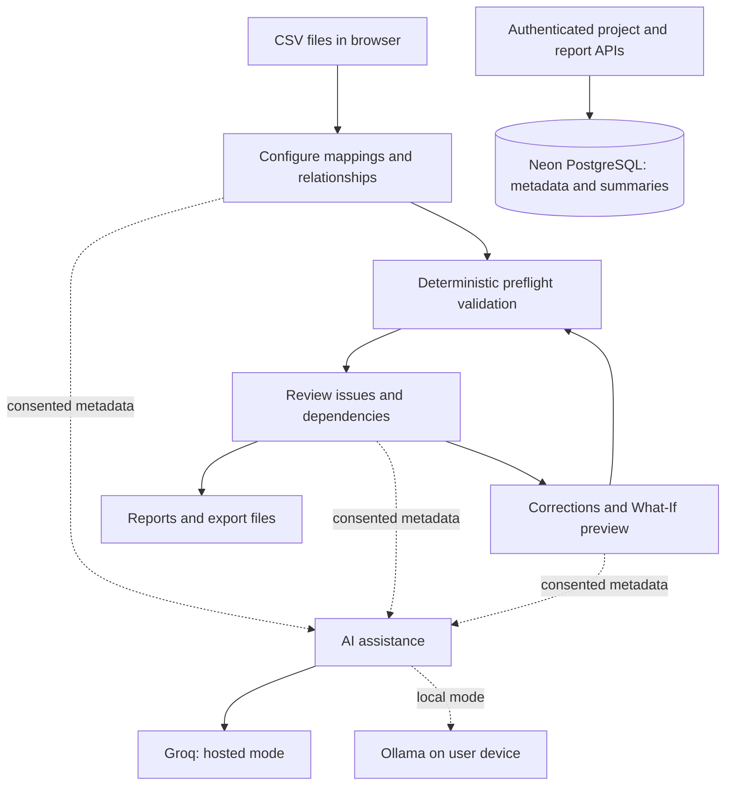

# Rowzen

**Clean data. Confident imports.**

[**Live application**](https://rowzen.vercel.app) · [**Features**](docs/features.md) · [**User guide**](docs/user-guide.md) · [**Testing overview**](docs/testing-overview.md)

Rowzen is a data-import preflight workspace for preparing CSV datasets before a database import. It combines configurable validation, cross-file relationship checks, issue investigation, controlled corrections, AI-assisted analysis, and export tools in one workflow.

Built as a Software Engineering final-year project, Rowzen helps teams and developers identify import blockers **before** data is sent to a target database.

> **Scope:** Rowzen validates and prepares data; it does not connect to or write into a live target database. Passing preflight checks does not guarantee a later import will succeed.

## What you can do

| Capability | Description |
|---|---|
| **Upload** | Inspect up to five CSV files per workspace, up to 1 MB each. |
| **Configure** | Map columns, set required fields and types, and configure primary, unique, and foreign keys across datasets. |
| **Validate** | Detect data-quality and relational-integrity problems with a deterministic TypeScript engine. |
| **Review** | Explore issues, analytics, dependencies, import-order guidance, and a schema diagram. |
| **Correct** | Edit cells, preview changes, use undo/redo, and automatically revalidate. |
| **Export** | Download reports, corrected CSV files, schema diagrams, and supported PostgreSQL, MySQL, and MongoDB artifacts. |

**Workflow:** Upload → Configure → Validate → Review → Correct → Export

For the complete capability map, see [Features](docs/features.md). For a practical walkthrough, see the [User guide](docs/user-guide.md).

## AI-assisted workflows

Rowzen offers three assistants in its workspace:

- **Schema Mapping & Drift Detection:** proposes source-to-target mappings and highlights possible schema differences during **Configure**.
- **Root-Cause & Impact Analyzer:** provides evidence-linked hypotheses for validation findings during **Review**.
- **Verified Smart Repair Planner:** proposes repair strategies during **Correct**, with deterministic What-If previews and explicit user approval before applying changes.

**AI works in both the local application and the deployed Rowzen app**, according to the latest maintainer verification. The deployed application uses **Groq-hosted inference**, while **Ollama** is supported for local inference. Visitors to the deployed application do not need to install Ollama. AI assistance depends on the selected provider's availability.

The deterministic validation engine remains authoritative: suggestions do not automatically change records, and a successful What-If check is not a guarantee of business correctness.

## Technology

| Layer | Technologies documented for the application |
|---|---|
| Frontend | Next.js 16, React 19, TypeScript, Tailwind CSS 4, Recharts, Lucide React |
| Data processing | Papa Parse, deterministic TypeScript validation and correction logic |
| Server and persistence | Next.js route handlers, Zod, Prisma 7, PostgreSQL on Neon |
| Authentication | Better Auth, GitHub and Google OAuth |
| AI | Groq (hosted), Ollama (local), structured and validated outputs |
| Testing | Vitest, Playwright, ESLint |
| Hosting | Vercel, Neon |

## Architecture at a glance

Raw CSV rows are processed in browser memory and are not saved to the application's database by default. Project metadata, configurations, and validation summaries can be persisted. Saved summaries do not restore the original CSV files.

## Try Rowzen

Open **[rowzen.vercel.app](https://rowzen.vercel.app)**. The public [/rehearsal demo](https://rowzen.vercel.app/rehearsal) supports a smaller 1–2-file validation scenario. Sign in to access projects and the full six-step workspace, including its AI-assisted features.

Read the [step-by-step user guide](docs/user-guide.md) for how to generate and review AI suggestions on the deployed app.

## Testing and verification

The maintainer confirms that the latest completed automated test runs **pass** and that all three AI features work in both local development and the deployed application. Exact counts for these most recent runs were not supplied for this showcase update.

For historical context, the source README recorded **781 passing Vitest tests** on November 1, 2026 and **462 passing Playwright tests** on October 31, 2026. Those are **previously documented runs, not a new test count**. The Playwright run used mocked AI responses; live AI functionality was verified separately by the maintainer.

See [Testing overview](docs/testing-overview.md) for test coverage, historical evidence, and verification boundaries.

## Limitations

- Up to five CSV files, 1 MB each; smaller limits in the public demo.
- Not every database constraint or live transaction is simulated.
- Preflight readiness is not a guarantee of successful import.
- Saved reports contain summaries, not a complete persisted CSV workspace.
- AI suggestions may be incomplete or incorrect; hosted inference relies on external provider availability.
- GraphQL export is not documented as an available user-facing feature.

## About this repository

This is the **public showcase and documentation repository**, not the application's complete source-code distribution. It contains product information for reviewers and recruiters. The implementation is maintained separately; this showcase does not grant access to the private source code.

**Author:** [Dharam Dan](https://github.com/dharamdan01) · Software Engineering Final Year Project, Sindh Madressatul Islam University, Karachi.
