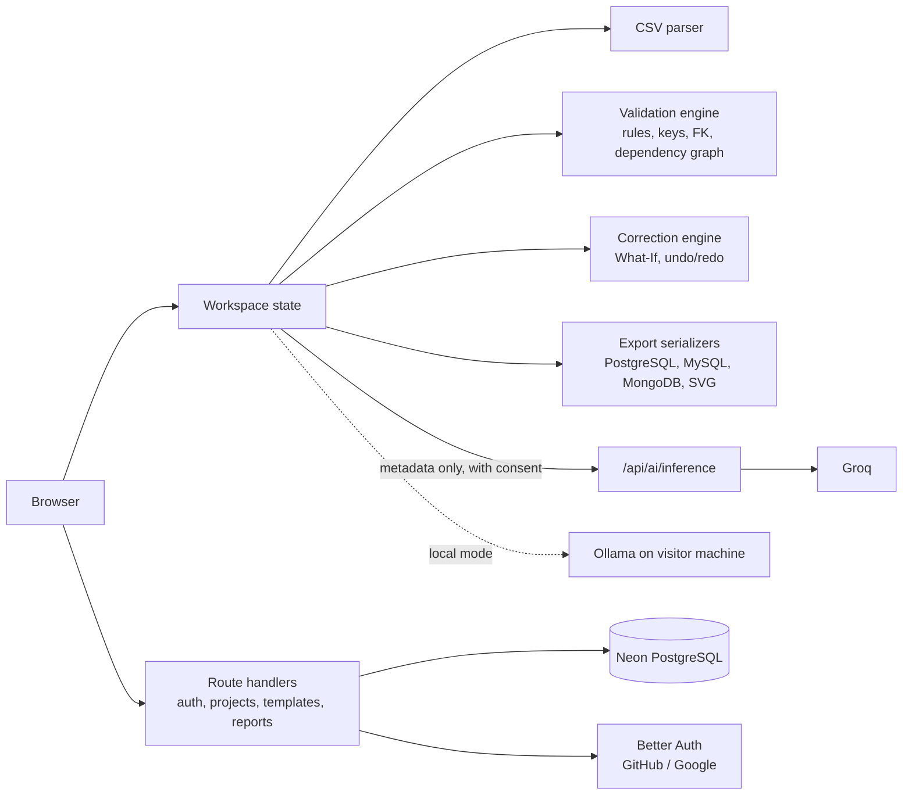

# Rowzen

**Clean data. Confident imports.**

Rowzen is a data-import preflight workspace. You upload CSV files, map them to the schema you expect, validate them (including relationships between files), fix problems in place, and export reports or database-ready files before anything reaches a real database.

- **Live app:** https://rowzen.vercel.app
- **Repository:** https://github.com/dharamdan01/rowzen
- **Stack:** Next.js 16 (App Router), React 19, TypeScript, Prisma 7, PostgreSQL (Neon), Better Auth, Vitest, Playwright
- **Project type:** Software Engineering Final Year Project (full-stack web application)

Rowzen began as "DataRehearsal"; some internal package names, storage keys and docs still use that name.


## The problem

CSV imports usually fail late. An order points at a customer that does not exist, a primary key is duplicated, a required column is empty, a number column contains text, or tables are loaded in the wrong order. The error shows up during the import, and the debugging starts after the damage.

Rowzen moves that discovery earlier. A deterministic TypeScript validation engine checks the data against rules you configure, a dependency graph shows the safe load order, and an editor lets you correct records and re-validate immediately.

> Rowzen is a preflight tool. It generates reports and export files. It does **not** connect to or write into your database, and a clean result does not guarantee that a later import will succeed.

## Features

- **Upload:** drag and drop or file picker, up to 5 CSV files per workspace, 1 MB each. Records are parsed and held in the browser.
- **Configure:** map source columns to target fields, set types, required fields, primary keys (including composite), unique constraints and foreign keys across datasets. Save and reuse project-owned mapping templates.
- **Validate:** required values, type checks, primary key and unique violations, foreign key integrity, relationship configuration errors, dependency cycles and a migration-readiness verdict. Results are reproducible and do not depend on any AI model.
- **Review:** summary cards, Issue Explorer with search, filters and pagination, error distribution charts, dataset analytics, dependency graph with suggested import order, and a schema (ER) diagram.
- **Correct:** inline cell editing, original versus current values, undo/redo, activity history, What-If previews, automatic re-validation and corrected CSV download.
- **Export:** validation reports (CSV and JSON), corrected CSV, SQL for PostgreSQL and MySQL, MongoDB collection definitions with JSONL records, and the schema diagram as SVG.
- **Accounts and projects:** GitHub and Google sign-in, project CRUD, saved validation summaries and report history.
- **Public demo:** `/rehearsal` lets visitors try a small validation run (1 or 2 CSV files) without signing in.


## Workflow

**Upload → Configure → Validate → Review → Correct → Export**


## AI-assisted features

Three optional assistants make suggestions. They never change data on their own, and the deterministic engine remains the source of truth.

| Assistant | Where | What it does |
|---|---|---|
| Schema Mapping and Drift Detection | Configure | Suggests source-to-target mappings from column metadata. You review and apply. |
| Root-Cause and Impact Analyzer | Review | Proposes hypotheses for validation findings, grounded in existing evidence. These are explanations, not proof. |
| Verified Smart Repair Planner | Correct | Proposes a repair strategy, resolves it locally, previews it with the What-If engine, and applies it only after explicit approval. |

How it is built:

- Requests and responses use typed contracts with strict output validation and grounding checks against current findings.
- Requests carry metadata only and require explicit consent. Cancellation and stale-response protection are built in.
- Two providers exist: **Groq** (hosted, model `openai/gpt-oss-20b`, called through the authenticated `/api/ai/inference` route with shared rate limits on Upstash Redis) and **Ollama** (local, `qwen2.5:0.5b` and `qwen2.5:1.5b`, called from the visitor's own machine).
- The provider is chosen at build time with `NEXT_PUBLIC_AI_PROVIDER`. Vercel builds are required to use `groq`, so the hosted site cannot ship the local-only default.
- A "verified" repair preview means the change passes your configured rules. It does not prove the value is the business-correct one.

The repository's own deployment notes state that live Groq/Redis inference on the deployed site was not verified end to end at the time of writing, and local tests use mocked responses. Treat hosted AI availability as dependent on external services.

## Tech stack

| Area | Technology |
|---|---|
| Frontend | Next.js 16.4.3, React 19.3, TypeScript, Tailwind CSS 4, Recharts, Lucide React |
| Server | Next.js route handlers and server components, Zod 4 |
| Database | PostgreSQL (Neon), Prisma 7 with the `pg` adapter |
| Auth | Better Auth with GitHub and Google OAuth |
| CSV | Papa Parse |
| AI | Groq (hosted) and Ollama (local), behind typed contracts |
| Testing | Vitest, Playwright, ESLint |
| Hosting | Vercel and Neon |

## Architecture



Parsing, validation, correction and export run in the browser. The server handles authentication, ownership-checked project and report APIs, and hosted AI requests.

**Persisted in PostgreSQL:** users, sessions, accounts, projects, dataset names and row counts, mapping and relationship configuration, mapping templates, and validation-run summaries. **Not persisted:** raw CSV rows.

### Routes

| Route | Purpose |
|---|---|
| `/` | Landing page |
| `/login` | Sign in |
| `/rehearsal` | Public demo |
| `/dashboard` | Authenticated overview |
| `/projects` | Project management |
| `/upload` | Six-step CSV workspace |
| `/results` | Saved report history |
| `/results/[reportId]` | Saved report summary |

API routes: `/api/auth/*`, `/api/projects/*` (datasets, mappings, relationships, runs, templates), `/api/reports/[id]`, `/api/ai/inference`, `/api/health`.

### Project structure

```text
src/app/            routes and API handlers
src/components/     ai, upload, validation, reports, corrections,
                    schema-diagram, database-export, templates, ui
src/lib/rehearsal/  validation engine, keys, foreign keys, dependency graph
src/lib/corrections/ edits, history, What-If, repair verification
src/lib/ai/         contracts, sessions, providers (Groq, Ollama), server handler
src/lib/database-export/  PostgreSQL, MySQL and MongoDB serializers
src/lib/security/   authorization and OAuth options
prisma/             schema and migrations
tests/              unit, integration and Playwright e2e suites
samples/            sample CSV files
docs/               PRD, SRS, architecture, security and verification notes
```

## Getting started

**Prerequisites:** Node.js 20.9 or newer (the project was last tested on Node 22), npm, a PostgreSQL database (a Neon free project works), and optionally GitHub/Google OAuth apps.

```bash
git clone https://github.com/dharamdan01/rowzen.git
cd rowzen
npm ci
cp .env.example .env        # on Windows PowerShell: Copy-Item .env.example .env
```

Fill in `.env` (see below), then prepare the database and start the app:

```bash
npx prisma migrate dev --config prisma7.config.ts
npx prisma generate --config prisma7.config.ts
npm run dev
```

Open http://localhost:3000. Use a development database for `migrate dev`. For a production database, apply existing migrations only with `prisma migrate deploy`.

### Environment variables

| Variable | Purpose |
|---|---|
| `DATABASE_URL` | Runtime connection string (the app throws if it is missing) |
| `DIRECT_URL` | Direct connection used by Prisma migrations |
| `BETTER_AUTH_SECRET` | Session signing secret |
| `BETTER_AUTH_URL` | App origin, for example `http://localhost:3000` |
| `GITHUB_CLIENT_ID`, `GITHUB_CLIENT_SECRET` | GitHub OAuth |
| `GOOGLE_CLIENT_ID`, `GOOGLE_CLIENT_SECRET` | Google OAuth (enabled only when both are set) |
| `NEXT_PUBLIC_AI_PROVIDER` | `ollama` (default) or `groq` |
| `AI_HOSTED_ENABLED` | `true` only when using `groq` |
| `GROQ_API_KEY` | Server-only Groq key |
| `AI_RATE_LIMIT_REDIS_REST_URL`, `AI_RATE_LIMIT_REDIS_REST_TOKEN` | Upstash Redis REST settings for shared AI rate limits (required for hosted production) |

Never commit real values, and never expose keys through `NEXT_PUBLIC_*` variables. OAuth callback URLs follow `<BETTER_AUTH_URL>/api/auth/callback/github` and `/google`.

### Optional: local AI with Ollama

Leave `NEXT_PUBLIC_AI_PROVIDER="ollama"` and `AI_HOSTED_ENABLED="false"`, install [Ollama](https://ollama.com), and pull a supported model (`qwen2.5:0.5b` or `qwen2.5:1.5b`). The app talks to `http://127.0.0.1:11434` from your browser. Core validation works without any AI.

## Scripts and tests

| Command | Description |
|---|---|
| `npm run dev` | Development server |
| `npm run build` | Generates the Prisma client, then builds |
| `npm start` | Serves the production build |
| `npm run lint` | ESLint |
| `npm test` | Vitest unit and integration suites |
| `npm run test:coverage` | Vitest with coverage |
| `npm run test:e2e` | Playwright end-to-end tests |

Public Playwright tests run against `PLAYWRIGHT_BASE_URL` (default `http://localhost:3000`). Authenticated tests are opt-in: set `PLAYWRIGHT_AUTH_STATE` to a storage-state file from a real login. Install browsers first with `npx playwright install chromium`.

**Latest verified run** (1 November 2026, this checkout, Node 22): `npm test` passed with **781 tests in 90 files, 0 failed, 0 skipped**. The Playwright suite was not re-run for this README. Repository notes from 31 October 2026 record a full local run of 462 passing e2e tests against a hosted-mode build, with mocked AI responses. That is not proof of production AI behavior.

## Privacy and security

- Uploaded CSV rows are processed in the browser and are not stored in the database.
- AI requests send metadata only, after explicit consent, and model output is validated before display.
- Route handlers check the session and verify project and report ownership on the server.
- Google sign-in requires a verified email. Account linking is explicit; implicit linking and linking across different emails are disabled.
- Secrets live in server-side environment variables. `scripts/check-ai-env.mjs` fails builds that would expose AI credentials publicly or ship a mismatched AI configuration.
- Hosted AI requests are rate limited through a shared Redis store.

This is a student project. It has not had an independent security audit, and the repository does not claim any compliance certification. See [`docs/security.md`](docs/security.md) for the project's security notes.

## Deployment

Rowzen is deployed on Vercel with Neon PostgreSQL. To deploy your own copy: create a Neon database, set the environment variables above in Vercel (use `NEXT_PUBLIC_AI_PROVIDER=groq` and `AI_HOSTED_ENABLED=true` for hosted AI), register OAuth callbacks for your domain, and redeploy after any change to a `NEXT_PUBLIC_*` variable because it is compiled into the client. Migrations should be applied with `prisma migrate deploy`.

`GET /api/health` reports database connectivity.

## Known limitations

- Preflight only: no live database connection or automatic import.
- Limited to 5 CSV files of 1 MB each (1 or 2 files in the public demo).
- The validation engine covers the rules listed above, not every database constraint, and it does not simulate transactions or live database state.
- GraphQL SDL appears in shared export contracts, but there is no GraphQL export interface.
- AI output can be wrong or abstain. Hosted AI depends on Groq and Upstash being configured and available.
- Saved reports store summaries only, not the full dataset or issue list.
- Local development uses Ollama on the visitor's machine, which deployed builds cannot reach.
- No LICENSE file is present in the repository, so no open-source license is granted.

## Background

Rowzen was built as a Software Engineering final year project at Sindh Madressatul Islam University, Karachi. Design documents are in [`docs/`](docs): [PRD](docs/PRD.md), [SRS](docs/SRS.md) and [architecture](docs/architecture.md).

## Author

**Dharam Dan** · [@dharamdan01](https://github.com/dharamdan01)
