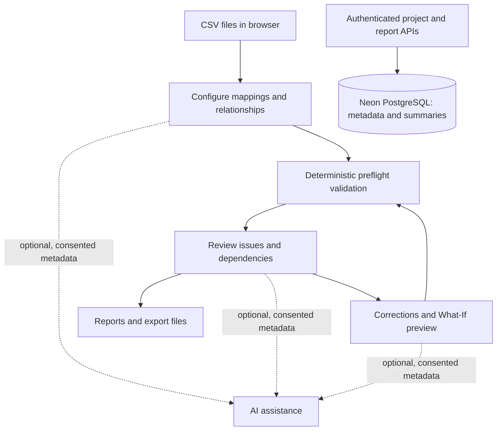

# Rowzen

**Clean data. Confident imports.**

[**Live application**](https://rowzen.vercel.app) · [**Features**](docs/features.md) · [**User guide**](docs/user-guide.md) · [**Testing overview**](docs/testing-overview.md)

Rowzen is a data-import preflight workspace for preparing CSV datasets before a database import. It combines configurable validation, cross-file relationship checks, issue investigation, controlled corrections, and export tools in one workflow.

Built as a Software Engineering final-year project, Rowzen explores how to detect import blockers **before** data is sent to a target database.

> **Scope:** Rowzen validates and prepares data; it does not connect to or write into a live target database. Passing its preflight checks does not guarantee a later import will succeed.

## What you can do

| Capability | Description |
|---|---|
| **Upload** | Inspect up to five CSV files per workspace, up to 1 MB each. |
| **Configure** | Map columns, set required fields and types, and configure primary, unique, and foreign keys across datasets. |
| **Validate** | Detect data-quality and relational-integrity problems with a deterministic TypeScript engine. |
| **Review** | Explore findings, data-quality analytics, dependencies, import-order guidance, and a schema diagram. |
| **Correct** | Edit cells, preview changes, use undo/redo, and automatically revalidate. |
| **Export** | Download reports, corrected CSV files, schema diagrams, and supported PostgreSQL, MySQL, and MongoDB artifacts. |

**Workflow:** Upload → Configure → Validate → Review → Correct → Export

For an explanation of each capability, see [Features](docs/features.md). For a practical walkthrough, see the [User guide](docs/user-guide.md).

## AI-assisted review

Rowzen includes three optional assistants:

- **Schema Mapping & Drift Detection:** suggests mappings and highlights possible schema changes.
- **Root-Cause & Impact Analyzer:** proposes evidence-linked explanations for validation findings.
- **Verified Smart Repair Planner:** suggests strategies that can be previewed through deterministic What-If checks before user approval.

AI suggestions are advisory. They do not change records without approval or replace the validation engine. The application supports a hosted Groq integration and a local Ollama mode; availability depends on configuration and provider access. The provided project documentation did not establish successful end-to-end hosted inference on the live site.

## Technology

| Layer | Technologies documented for the application |
|---|---|
| Frontend | Next.js 16, React 19, TypeScript, Tailwind CSS 4, Recharts, Lucide React |
| Data processing | Papa Parse, deterministic TypeScript validation and correction logic |
| Server and persistence | Next.js route handlers, Zod, Prisma 7, PostgreSQL on Neon |
| Authentication | Better Auth, GitHub and Google OAuth |
| AI | Groq, Ollama; structured and validated outputs |
| Testing | Vitest, Playwright, ESLint |
| Hosting | Vercel, Neon |

## Architecture at a glance

Raw CSV rows are processed in browser memory and are not saved to the application database by default. Project metadata, configurations, and validation summaries can be persisted. Saved summaries do not restore the original CSV files.

## Try Rowzen

Open [rowzen.vercel.app](https://rowzen.vercel.app). The public `/rehearsal` demo supports a smaller 1–2-file validation scenario. Sign in to access projects and the full six-step workspace. See the [step-by-step guide](docs/user-guide.md).

## Verification

The supplied README records the following results, not tests performed as part of this showcase:

| Recorded verification | Result | Scope |
|---|---|---|
| Vitest, November 1, 2026 | **781 passed** in 90 files; 0 failed, 0 skipped | Local unit/integration tests on Node 22 |
| Playwright, October 31, 2026 | **462 passed** | Local hosted-mode build, using mocked AI responses |
| Live hosted Groq + Redis inference | **Not verified end to end** in the supplied documentation | Must not be represented as proven by mocked tests |

Details and limitations: [Testing overview](docs/testing-overview.md).

## Limitations

- Up to five CSV files, 1 MB each; smaller limits in the public demo.
- Not every database constraint or live transaction is simulated.
- Preflight readiness is not a guarantee of successful import.
- Saved reports contain summaries, not a complete persisted CSV workspace.
- AI can return incorrect or insufficient recommendations and depends on provider availability.
- GraphQL export was not documented as an available user-facing feature.

## About this repository

This is the **public showcase and documentation repository**, not the application's complete source-code distribution. It contains product information for reviewers and recruiters. The implementation is maintained separately; access to private source code is not implied by this repository.

**Author:** [Dharam Dan](https://github.com/dharamdan01) · Software Engineering Final Year Project, Sindh Madressatul Islam University, Karachi.

